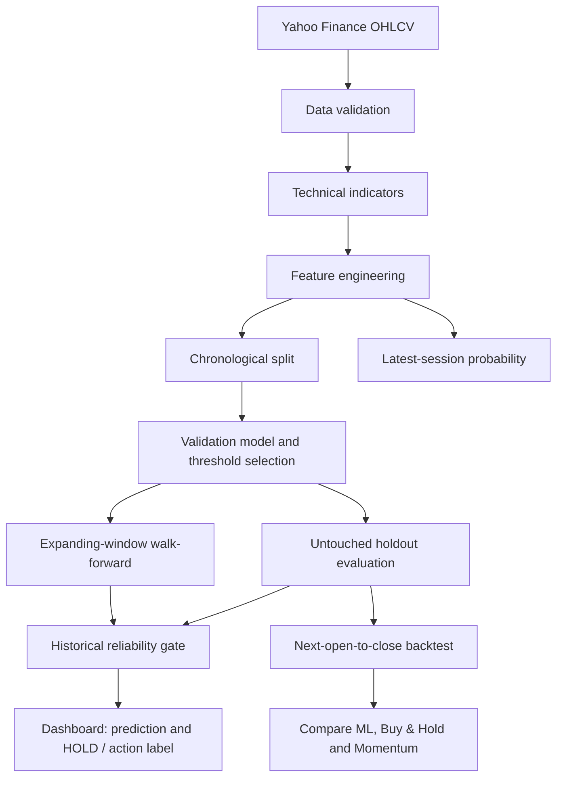

# Market Intel

**Indian Stock Intelligence & One-Day Market Direction Research**

Market Intel is an educational research application for analysing NSE-listed equities. It combines historical OHLCV data, technical-indicator engineering, supervised classification, chronological evaluation and a transaction-cost-aware backtest in an interactive Streamlit dashboard.

The project investigates a deliberately narrow question:

> Do historical price, momentum, volatility and volume features contain useful information for classifying whether the next trading session's close-to-close return will be positive?

It is a research prototype—not an automated trading system, investment recommendation or financial-advice service.

---

## At a glance

- **Data:** daily Open, High, Low, Close and Volume (OHLCV) from Yahoo Finance
- **Universe:** selectable NSE-listed equities (Yahoo Finance `.NS` symbols)
- **Prediction horizon:** next trading session only
- **Target:** positive vs. non-positive next-session close-to-close return
- **Models:** Logistic Regression, Random Forest, Gradient Boosting and HistGradientBoosting
- **Feature sets:** compact 12-feature set and full 30-feature set
- **Evaluation:** chronological train/validation/test split and four expanding-window walk-forward folds
- **Backtest:** next-session open-to-close execution with transaction costs
- **Interface:** Streamlit

## Main capabilities

### 1. Market dashboard
- Downloads and validates daily OHLCV data.
- Displays the latest close, daily change, RSI and ADX.
- Visualises closing price with moving averages.
- Shows a recent technical-indicator snapshot.

### 2. One-day direction estimate
- Estimates the probability that the next session's close-to-close return is positive.
- Selects a classification threshold using validation data.
- Uses a conservative reliability gate: when holdout and repeated walk-forward evidence are insufficient, the application displays **HOLD — insufficient historical edge**.

### 3. Model comparison and evaluation
- Compares four classifiers across two feature sets (eight candidates).
- Selects the model and threshold using validation Macro F1.
- Reports accuracy, majority-class baseline, Macro F1, balanced accuracy, ROC-AUC, log loss and a confusion matrix.
- Reports four chronological walk-forward folds and permutation feature importance.

### 4. Strategy backtesting
- Compares ML Signal, Buy & Hold and Momentum.
- Generates signals after session close, enters at the following session's open and exits at that session's close.
- Includes transaction costs and reports total return, maximum drawdown, Sharpe ratio, win rate and exposure.

---

## Repository structure

The codebase separates the Streamlit presentation layer from reusable data, feature, modelling and evaluation logic.

```text
Market_Intel/
├── app.py                         # Streamlit entry point and dashboard UI
├── market_intel/                  # Reusable project package
│   ├── __init__.py
│   ├── data_loader.py              # Yahoo Finance download and OHLCV validation
│   ├── technical_analysis.py       # Technical-indicator calculations
│   ├── ml_pipeline.py              # Feature engineering, model selection and walk-forward
│   ├── evaluation.py               # Holdout metrics, baselines and feature importance
│   └── backtesting.py              # Execution-aware strategy simulation
├── scripts/
│   └── benchmark_validation.py     # Reproduce offline benchmark from a CSV ZIP
├── docs/
│   ├── AUDIT_RESULTS.md             # Five-stock benchmark, results and limitations
│   └── LAB_EVALUATION_GUIDE.md      # Methodology, concepts and viva preparation
├── results/
│   ├── benchmark_holdout_results.csv
│   ├── benchmark_walk_forward_results.csv
│   └── benchmark_backtest_results.csv
├── archive/
│   └── previous-version/            # Earlier implementation retained for reference
├── validate_project.py              # Deterministic synthetic-data integration check
├── requirements.txt
├── runtime.txt
├── VERSION.txt
├── LICENSE
└── .gitignore
```

### Application flow



---

## Installation and execution

**Requirements:** Python 3.11 recommended.

### 1. Clone the repository

```bash
git clone https://github.com/Chitesh-Jindal/Market_Intel.git
cd Market_Intel
```

### 2. Create and activate a virtual environment

macOS / Linux:

```bash
python3.11 -m venv .venv
source .venv/bin/activate
```

Windows PowerShell:

```powershell
py -3.11 -m venv .venv
.venv\Scripts\Activate.ps1
```

### 3. Install dependencies

```bash
python -m pip install --upgrade pip
python -m pip install -r requirements.txt
```

### 4. Launch the dashboard

```bash
python -m streamlit run app.py
```

Choose an NSE ticker and a historical period. Five years is recommended because indicator warm-up, chronological partitions and repeated validation require sufficient observations. Click **Run Market Intel** to execute the analysis.

### 5. Run the integration check

```bash
python validate_project.py
```

This check generates deterministic synthetic OHLCV data and exercises indicators, feature construction, model selection, holdout metrics, walk-forward evaluation, feature importance and backtesting. It checks software integration; synthetic results are **not** evidence of stock-market predictive performance.

---

## Methodology

### Prediction target

For each completed trading session (t):

```text
Next_Day_Return(t) = Close(t+1) / Close(t) - 1

Target(t) = 1, if Next_Day_Return(t) > 0
            0, otherwise
```

The feature vector uses information available through the close of session (t). Forward return and next-session prices are retained only for labels and backtesting; they are not part of the model feature list.

### Feature engineering

The full feature set contains 30 variables covering:

- Lagged returns (1, 2, 5, 10 and 20 sessions)
- Rolling volatility (5, 10 and 20 sessions)
- Distance from SMA/EMA trend levels and moving-average spreads
- RSI, MACD histogram and Bollinger Band measures
- ADX, ATR, Stochastic Oscillator and CCI
- OBV change and relative/standardised volume
- Daily range, open-to-close return and distance from recent highs/lows

A compact 12-feature subset is evaluated alongside the full set. More features are not assumed to be better.

### Model selection

Four fixed classifier configurations are compared across the two feature sets. Logistic Regression uses a StandardScaler inside a scikit-learn Pipeline. The candidate with the best validation Macro F1 is selected; its probability threshold is also tuned on validation data.

### Leakage-aware evaluation

- Data is split chronologically, not randomly.
- The single holdout uses a 60/20/20 train/validation/test design.
- A one-observation purge is applied at split boundaries because each target uses the following session.
- Model and threshold selection use validation data only.
- The final holdout is kept out of model selection.
- Four expanding-window folds repeat the train → validation → later test process.
- Each fold's majority-class baseline is derived from that fold's training-plus-validation observations.

### Backtest assumptions

The classifier's target is close-to-close, but a signal is only available after the current session closes. The backtest therefore enters at the next session's open and exits at that session's close. It deducts 0.10% per side for ML and Momentum trades; Buy & Hold includes entry and final liquidation costs.

The backtest return segment (next-open-to-close) is related to, but not identical to, the classifier target (close-to-close). This distinction is important when interpreting results.

---

## Benchmark findings

The committed audit covers five supplied NSE datasets: Reliance, TCS, HDFC Bank, Infosys and ICICI Bank. The historical window is 25 November 2021 to 25 November 2026.

Across 20 ticker-fold walk-forward test windows:

| Metric | Result |
|---|---:|
| Mean test accuracy | **50.92%** |
| Mean majority-baseline accuracy | **50.67%** |
| Mean accuracy edge | **+0.25 percentage points** |
| Mean Macro F1 | **0.452** |
| Mean balanced accuracy | **0.506** |
| Mean ROC-AUC | **0.506** |
| Folds beating their own baseline | **10 / 20** |

The small average difference over baseline, near-0.50 ROC-AUC and inconsistent fold results do not establish a reliable predictive edge. The five-stock backtest also did not establish consistent profitability. The application intentionally reports these limitations instead of presenting model output as a dependable trading signal.

Detailed results and per-stock breakdowns are available in [docs/AUDIT_RESULTS.md](docs/AUDIT_RESULTS.md) and the CSV files in [results/](results/).

---

## Project documentation

- **[Lab evaluation and viva guide](docs/LAB_EVALUATION_GUIDE.md)** — problem statement, concepts, algorithm explanations, evaluation design and common viva questions.
- **[Benchmark audit](docs/AUDIT_RESULTS.md)** — experimental results, per-stock analysis, backtest outcomes and engineering decisions.
- **[Version information](VERSION.txt)** — current release scope.

## Limitations and responsible use

- Daily stock returns are noisy and market relationships are non-stationary.
- A small average difference over a baseline may not be statistically meaningful.
- Model probabilities are not guaranteed to be calibrated.
- Backtest outcomes depend on price data, execution assumptions and transaction-cost estimates.
- Yahoo Finance data availability, ticker coverage and adjustment behaviour may change.
- Historical performance does not guarantee future results.

Market Intel is intended for academic demonstration and experimentation. It does not connect to brokers, place orders, manage a portfolio or provide financial advice.

## License

See [LICENSE](LICENSE).
